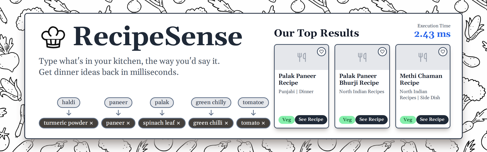
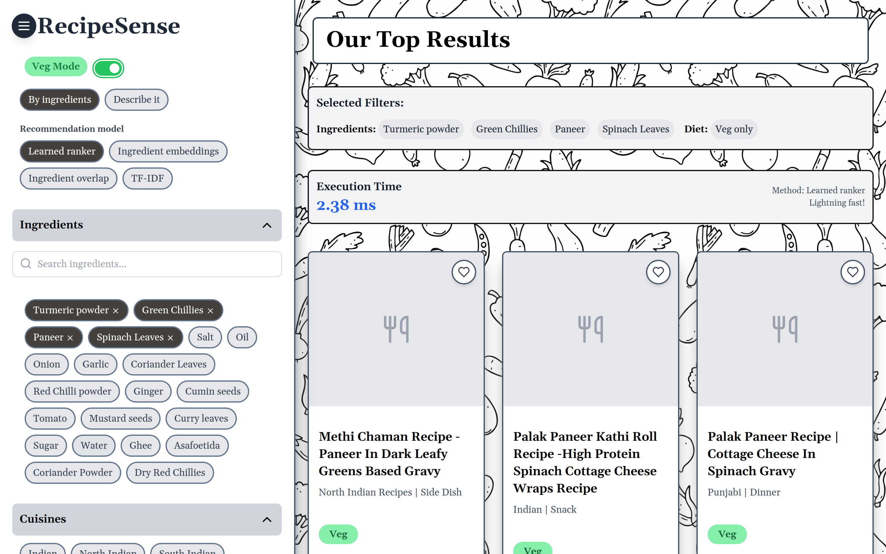
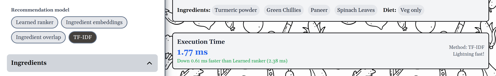
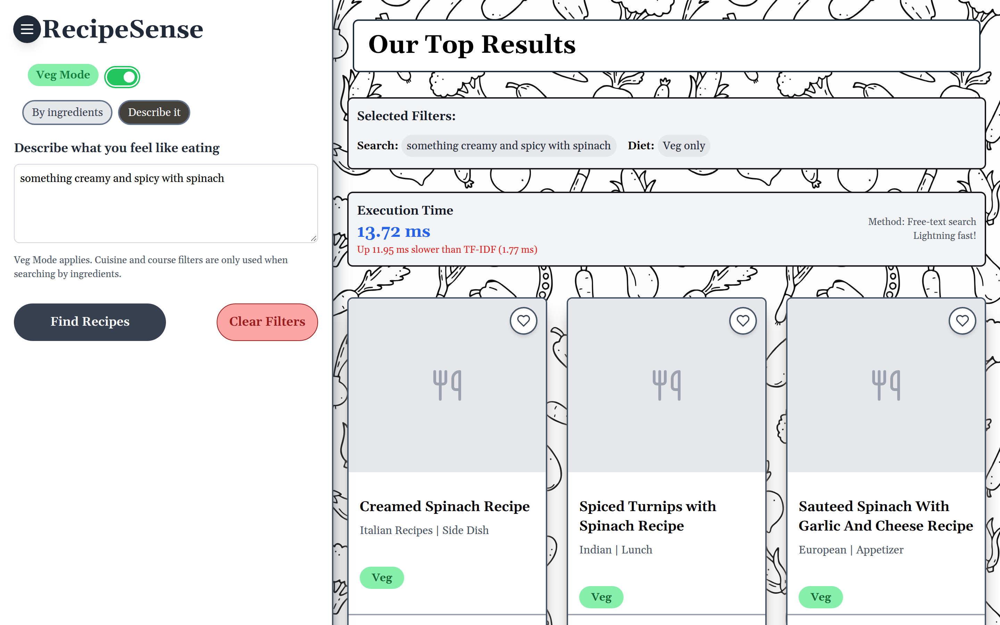
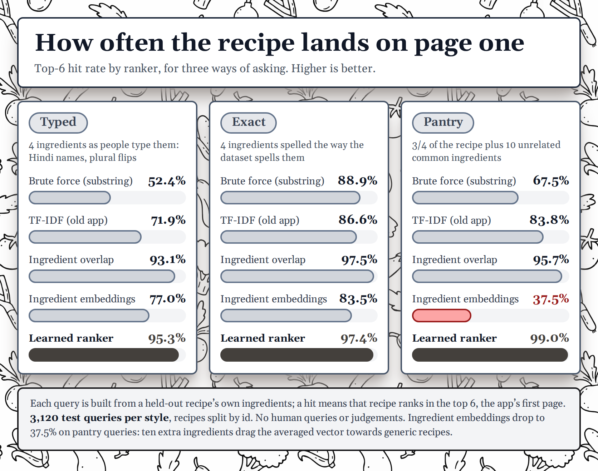
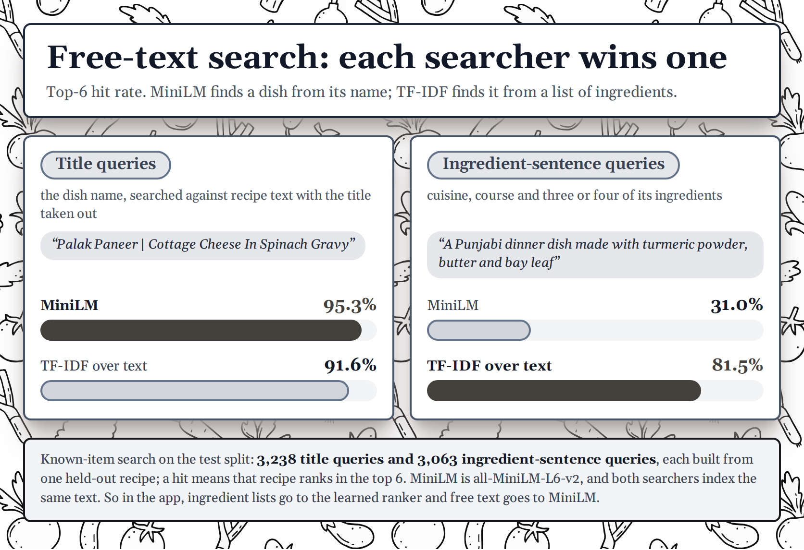
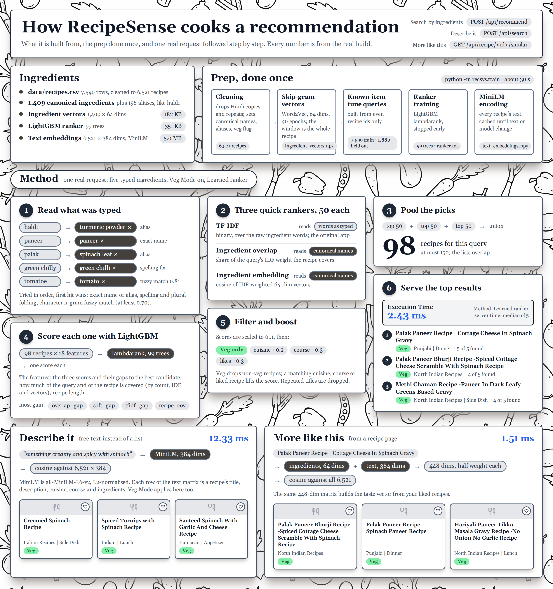

<div align="center">



<br>
<br>

**Type what is in your kitchen, or describe what you feel like eating. RecipeSense ranks 6,521 recipes in about 3 ms.**

**[Results](#how-good-is-it)** &nbsp;&nbsp;|&nbsp;&nbsp; **[Under the hood](#under-the-hood)** &nbsp;&nbsp;|&nbsp;&nbsp; **[API](api/README.md)** &nbsp;&nbsp;|&nbsp;&nbsp; **[Plan and audit](docs/ML_PLAN.md)**

</div>

---

## What it does

**Search by ingredients, typed the way people type them.** "haldi", "turmeric powders" and
"Turmeric powder (Haldi)" are one ingredient. Typed names are resolved to canonical ones, three
cheap rankers nominate candidates, and a LightGBM `lambdarank` model re-orders them. Pick the
ranker yourself and the app shows the server's measured time next to the previous one.





**Describe what you want instead.** "something creamy and spicy with spinach" is embedded with
`all-MiniLM-L6-v2` and matched against every recipe's text. **More like this** on a recipe page
finds neighbours in a joint space of ingredient vectors and text vectors.



<sub>The grey tiles are the app's fallback for a photo that did not load. Photos are hotlinked
from the recipe source, which refused the machine these screenshots were taken on.</sub>

**Likes without an account.** Liked recipes are kept in the browser and sent with each search.
They build a taste vector that re-ranks the results. Filters for vegetarian, cuisine and course
use grouped labels, so "Indian" also covers Kerala, Punjabi, Bengali and the other regional labels.

## Try it in Python

```python
from recsys.service import Recommender

rec = Recommender()

# 1. Ingredients, typed the way people type them
for r in rec.recommend(["haldi", "paneer", "palak", "green chilly"], veg=True, limit=3):
    print(f"{r['score']:.2f}  {r['total_time']:>3} min  {r['title']}")

# 2. Free text
for r in rec.search("something creamy and spicy with spinach", limit=3):
    print(f"{r['score']:.2f}  {r['title']}")

# 3. More like this
for r in rec.similar(210, limit=3):   # 210 is Paneer And Spinach Puff
    print(f"{r['score']:.2f}  {r['title']}")
```

```
1.00   40 min  Methi Chaman Recipe -Paneer In Dark Leafy Greens Based Gravy
0.77   45 min  Palak Paneer Kathi Roll Recipe -High Protein Spinach Cottage Cheese Wraps Recipe
0.69   60 min  Palak Paneer Recipe | Cottage Cheese In Spinach Gravy

0.73  Creamed Spinach Recipe
0.68  Spiced Turnips with Spinach Recipe
0.68  Sauteed Spinach With Garlic And Cheese Recipe

0.84  Paneer Cheese Puffs Recipe
0.83  Spinach and Paneer Cornmeal Roll Recipe
0.81  Spinach Paneer Kofta Curry Recipe
```

| Detail | What to know |
|---|---|
| `model` | `learned` by default. Also `overlap`, `embedding` and `tfidf`, for comparison |
| `score` | Scaled to 0..1 within a result list, then cuisine, course and like boosts are added. Compare within a list, not across lists |
| `veg` | Uses a cleaned flag. "Vegetarian" rows that list meat or eggs are not vegetarian |
| `liked` | A list of recipe ids. They shape the ranking and are left out of the results |
| Ids | The row number in `data/recipes.csv` |

## How good is it

There are no ratings or click logs, so the evaluation is known-item search. A query is built from
a held-out recipe's own ingredients, and a ranker scores well if that recipe comes back near the
top. Recipes are split by id: half for tuning and training, half for reporting. 3,120 test queries
per style. Source: [docs/results.json](docs/results.json).

Share of queries where the source recipe is in the top 6, the app's first page:

| Ranker | typed | exact | pantry |
|---|---|---|---|
| Brute force (substring count) | 52.4% | 88.9% | 67.5% |
| TF-IDF (the original app) | 71.9% | 86.6% | 83.8% |
| Ingredient overlap on cleaned names | 93.1% | **97.5%** | 95.7% |
| Ingredient embeddings alone | 77.0% | 83.5% | 37.5% |
| **Learned ranker** | **95.3%** | 97.4% | **99.0%** |

| Query style | How it is built |
|---|---|
| typed | Four ingredients the way people type them: the Hindi alias half the time, singular and plural flipped |
| exact | Four ingredients spelled as the dataset spells them |
| pantry | Three quarters of the recipe plus ten unrelated common ingredients |



Top-1 for the learned ranker is 80.5% / 85.5% / 95.3%, against 45.1% / 61.9% / 66.8% for TF-IDF.

**Free-text search**, same split, about 3,100 queries per style:

| Searcher | Recipe title, top 6 | Ingredient sentence, top 6 |
|---|---|---|
| TF-IDF over recipe text | 91.6% | **81.5%** |
| MiniLM | **95.3%** | 31.0% |



Most of the gain is data cleaning: resolving aliases and plurals takes typed queries from 72% to
93% before any model is trained. The learned ranker adds the rest, mostly on pantry queries, where
it learns to ignore ingredients the recipe does not use. MiniLM finds a dish from its name better
than TF-IDF and is much worse on a list of ingredients, so ingredient search goes to the ranker
and free text goes to MiniLM.

> **What did not work.** Ingredient embeddings do not improve ranking. On their own they collapse
> on pantry queries (37.5%), because averaging in ten extra ingredients drags the query vector
> towards generic recipes. An ablation that removed their features from the learned ranker left
> its held-out score unchanged. They are kept for "more like this", which is what co-occurrence
> vectors are good at.

> **What this does not measure.** Known-item search checks whether the right recipe can be found,
> not whether people like the list. There are no human queries or judgements behind these numbers.

## Run it

```bash
git clone https://github.com/Deeptanshuu/recipesense.git
cd recipesense
pip install -r requirements.txt
```

Start the API on http://localhost:5000. The trained models are committed, so there is nothing to
download except the MiniLM weights on first use:

```bash
python -m api.app
```

Then the web app, on http://localhost:5173:

```bash
cd web && npm install && npm run dev
```

It runs on CPU. Set `VITE_API_URL` in `web/.env` if the API is somewhere else.

## Retrain and re-measure

| Task | Command |
|---|---|
| Train ingredient vectors and the ranker, about 30 s | `python -m recsys.train` |
| Evaluate the ingredient rankers on `test` | `python -m recsys.evaluate` |
| Evaluate free-text search | `python -m recsys.eval_semantic` |
| Tests (123) | `python -m pytest` |
| Web lint and build | `cd web && npm run lint && npm run build` |
| Rebuild the README images | `node docs/images/src/build.mjs` (needs playwright-core, see the file header) |

Training uses only queries from the tune half, with part of it held out by recipe for early
stopping. No test query is used for training or tuning.

## Under the hood



Typed ingredients are resolved to canonical names, with a character n-gram fallback for
misspellings. The overlap and embedding rankers work on those names, TF-IDF on the text as typed,
and each nominates 50 recipes. The learned
ranker scores the union on 18 features, the strongest being each candidate's gap to the best
overlap score for that query. Cuisine, course, vegetarian and likes are applied last. Free text
skips all of that: the query is embedded once and compared against a 6,521 x 384 matrix.

| Doc | Covers |
|---|---|
| [API](api/README.md) | Endpoints, request and response shapes, environment variables |
| [Plan and audit](docs/ML_PLAN.md) | The original plan and the bugs found in the first version |
| [Results](docs/results.json) | Every metric for every ranker and query style |

```
recsys/     data cleaning, baselines, embeddings, learned ranker, text search, evaluation
api/        Flask routes over one Recommender object
web/        React, Vite and Tailwind front end
models/     ingredient vectors (180 KB), ranker (350 KB), text embeddings (5 MB)
data/       recipes.csv, 7,540 rows
tests/      pytest suite
```

## Data

7,540 recipes with name, description, cuisine, course, diet, ingredients, times, steps and a photo
link. 6,521 remain after removing Hindi copies of English recipes, plain repeats and Hindi-only
rows. The cleaning also handles "Vegetarian" rows that list meat or eggs, 78 cuisine labels for
what a person would call a dozen cuisines, and the same ingredient spelled many ways.

## Acknowledgements

Recipes and photos: [Archana's Kitchen](https://www.archanaskitchen.com).
Text encoder: [all-MiniLM-L6-v2](https://huggingface.co/sentence-transformers/all-MiniLM-L6-v2) (Reimers and Gurevych).
Ingredient vectors: gensim Word2Vec. Ranker: LightGBM.

## Copyright

Registered with the Copyright Office, Government of India, as "Recipesense": certificate
SW-2025020495, application 38904/2024-CO/SW, filed 11 December 2024, registered 13 May 2025.
Authors: Dr. Smita Bharne, Nauman Pathan, Deeptanshu Lal, Sara Pathan, Soham Pardhi.
